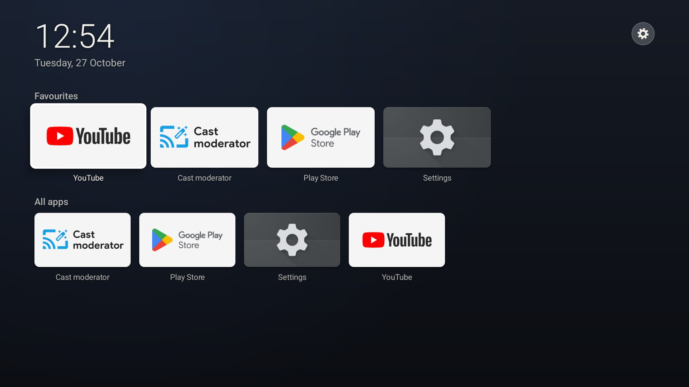
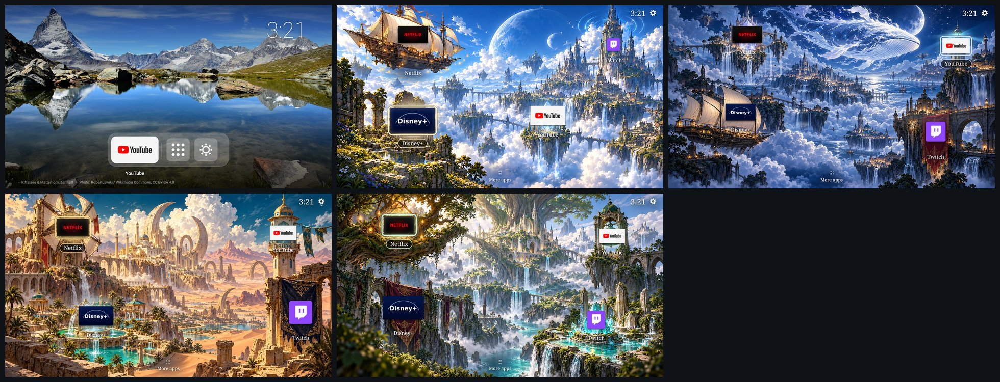
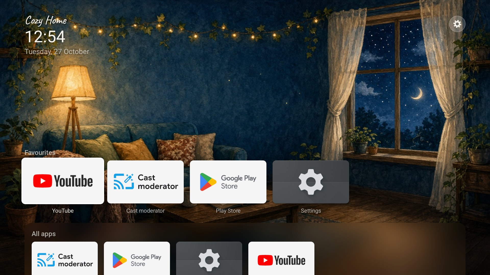
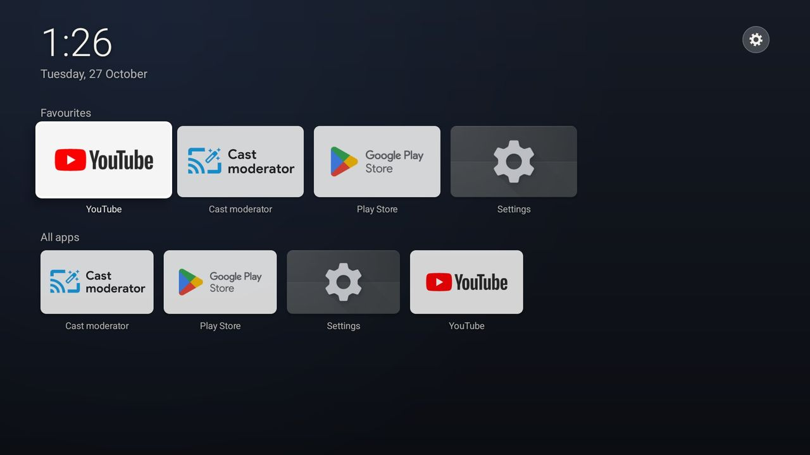
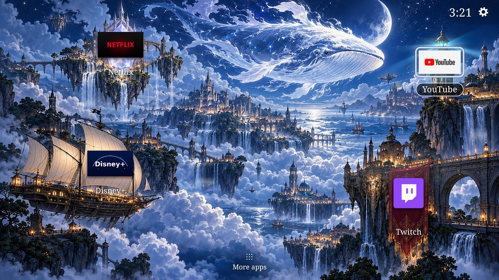
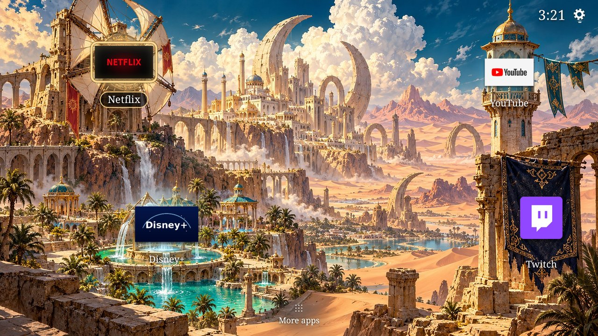
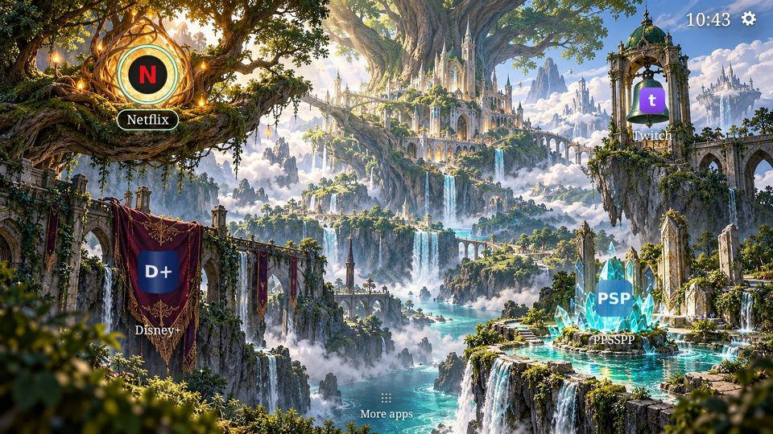

# Cozy Home TV

**A fast, clean home screen for Android TV and Google TV, with painted picture themes that put your apps inside
the scene, and an optional cozy look made from your own pictures and music.**

Out of the box it's a calm, plain launcher: a clock, a row of your favourite apps and every other app in a grid
below. No ads, no rows of recommendations. Pick a theme in Settings > Theme: Clean, or one of four picture themes
(Sky Kingdom, Moonlit Whale, Desert Kingdom, World Tree) where your 4 favourite apps sit inside a painting with its
own music. Or switch on the **Cozy look** and your home screen becomes a picture you
love (one picture, or a different one for morning, day, evening and night) with your own music playing softly
while you choose what to watch.





> Screenshots from the Android TV emulator. Photos on a real TV coming soon.

## Quick start: one command

On a Mac or Linux computer on the same Wi-Fi as the TV:

```bash
git clone https://github.com/LaRs21/cozy-home-tv && cd cozy-home-tv
./setup.sh
```

It walks you through everything and asks before it changes anything:

1. checks for `adb` and offers to install it (Homebrew, or Google's platform-tools download),
2. finds the TV, or pairs with it (Android 11+ wireless debugging), with on-screen steps for developer mode,
3. identifies the brand, model and chip and picks the matching debloat list,
4. **writes a backup record of the TV's settings, plus a plain-adb undo script, before any change**,
5. lets you pick a theme (Clean is the default),
6. optionally turns off apps you don't use (off by default; none / safe / more),
7. optionally copies your own pictures and music (a Cozy pack),
8. installs the signed release APK after checking its SHA-256,
9. makes it the home screen with the Home-button service (Google's launcher stays on), presses Home from
   inside another app to prove it works, and puts everything back by itself if it doesn't,
10. sets the screensaver, shows a final check and reminds you to turn debugging off.

```bash
./setup.sh --dry-run                       # print every command it would run on the TV; change nothing
./setup.sh --yes --ip 192.168.1.50 --theme sky_kingdom            # no questions, defaults for the rest
./setup.sh --ip 192.168.1.50 --debloat safe --pack my-pictures/
./restore.sh --ip 192.168.1.50             # undo everything, from the backup record
./doctor.sh --ip 192.168.1.50              # read-only health check (after a TV update or reboot)
```

`./setup.sh --help` lists every option. Windows: not yet (WSL may work but is untested).
Prefer a coding agent? Paste [PROMPT.md](PROMPT.md).

## Features

- **One command:** `./setup.sh` installs, sets Home, picks a theme and can debloat, with a backup record, a
  dry run and a full undo (`./restore.sh`).
- **Five themes, zero setup** (see [Themes](#themes)). Clean is the default: eight Swiss landscape photos (CC BY-SA,
  credited on screen), a thin clock and one frosted dock with All apps and Settings.
- **Four picture themes:** four paintings with 4 app spots each, built into the scene (a sail, a crystal,
  a lantern, a banner...). Any app fits any spot, drawn in that object's style. Each has its own quiet music and
  gentle motion (see [Themes](#themes)).
- **Themes are pluggable** (`Theme.java`, `Themes.java`, picture packs: [docs/theme-packs.md](docs/theme-packs.md)).
- **Your apps, your order:** hold OK (or press Menu) on an app to add it to favourites, move it, hide it,
  open its info or uninstall it. New apps show up by themselves.
- **Cozy look (optional):** your own picture(s), time-of-day switching, looping music with a volume setting,
  your own card art for favourite apps, soft fireflies. All from a folder on the TV.
- **Screensaver:** the theme's painting (or your Cozy picture) with a small clock in the theme's font, or a
  big clock on a dark background with the Clean theme.
- **Home-button fix for Google TV (optional):** stops the Google TV home flashing up before your launcher.
- **Light on memory:** made for 2 GB TVs. Pictures are decoded at screen size into GPU memory, and only the one
  on screen is kept (two for the few seconds of a crossfade). Music and animation stop the moment you open an app,
  and pictures are freed when the system needs memory.
- **No network, no tracking, no ads.** About 9 MB (mostly the paintings and music). MIT licensed.

## How it compares with other approaches

There are a few common ways to get a calmer Android TV home screen. All of them are reasonable; they make
different trade-offs.

| | Debloat only | Replace the launcher by turning off the stock one | Closed-source launcher app | Cozy Home TV |
|---|---|---|---|---|
| What changes | stock apps turned off or removed | the stock launcher (and on Google TV its setup app) turned off | a launcher from the Play Store | an open-source launcher next to the stock one |
| Google TV features (Settings button panel, casting, profiles) | kept | can be lost, and Wi-Fi can drop on some TVs | usually kept | kept: the stock launcher stays on |
| Setup | a script or an agent prompt | a script or an agent prompt | install from the store, then settings on the TV | `./setup.sh`, or an agent prompt |
| Undo | depends on the tool's log | re-enable the stock apps | uninstall | `./restore.sh` from a backup record, or the generated plain-adb script |
| Build tools needed | no | often (build the launcher yourself) | no | no (signed APK with a checksum); building is optional |

Thanks to [tv-home](https://github.com/mihirgupta0900/tv-home) and the projects around it for the idea and
for documenting what they learned on real TVs.

## Manual install (step by step)

`./setup.sh` does all of this. To do it by hand you need a computer with `adb` (macOS: `brew install android-platform-tools`) on the same Wi-Fi as the TV.

1. **On the TV:** Settings > System > About > press OK on **Build** 7 times. Back > Developer options >
   turn on **USB debugging** (and **Network/Wireless debugging** if listed). Note the TV's IP address
   (Settings > Network).
2. **Get the APK:** download `cozy-home-tv-<version>.apk` and its `.sha256` from [Releases](../../releases)
   (check it: `shasum -a 256 -c cozy-home-tv-<version>.apk.sha256`), or build it (below).
3. **Install and set as home:**

   ```bash
   scripts/install.sh 192.168.1.50                 # accept "Allow debugging?" on the TV the first time
   scripts/set-home.sh 192.168.1.50                # make Cozy Home TV the home screen
   scripts/set-home.sh 192.168.1.50 --home-fix     # optional: Google TV Home-button fix
   scripts/set-home.sh 192.168.1.50 --screensaver  # optional: use the Cozy Home TV screensaver
   ```

   Without the scripts:

   ```bash
   adb connect 192.168.1.50:5555
   adb install -r cozy-home-tv-1.2.0.apk
   adb shell cmd package set-home-activity io.github.lars21.cozyhometv/.HomeActivity
   adb shell cmd role add-role-holder android.app.role.HOME io.github.lars21.cozyhometv   # Android 10+
   ```

4. Press **Home** on the remote.

### Do it with a coding agent

Open this repo in Claude Code, Cursor or another coding agent and paste the prompt in **[PROMPT.md](PROMPT.md)**.
It finds the TV, builds and installs the app, and asks you about the Home-button fix, the screensaver,
the Cozy look and debloating before changing anything.

## Safety: what it never touches, and how to undo

**Before it changes anything,** `setup.sh` saves a backup record in `~/.cozy-home-tv/tvs/<TV>/`: which apps
are on or off, which app opens on Home, the accessibility services, the screensaver and the animation
settings. The **first record is never overwritten**, so a second run can't hide the TV's original state.
Next to it is `restore-<TV>.sh`, plain `adb` commands that undo everything even without this repo, and
`changes-<time>.log`, every command that changed the TV.

**It never:**

- uninstalls anything (apps are only turned off with `pm disable-user`, and only if you choose a tier),
- turns off the stock launcher (`launcherx` / `tvlauncher`) or Google TV's setup app (`setupwraith`), so the
  Settings button, casting and the saved Wi-Fi keep working,
- touches Google Play services or the Play Store, keyboards, Live TV / tuner / HDMI input apps, system updates
  (OTA), network and Wi-Fi, System UI, or the chip vendors' (Realtek, MediaTek, MStar) system packages. This
  protect list is in the code (`scripts/lib.sh`) and a list file can't override it,
- changes the display size or density, reboots the TV, or uses `screenrecord`,
- sends anything anywhere: no network access in the app, no tracking.

**Undo:**

```bash
./restore.sh --ip 192.168.1.50                         # apps back on, Home, accessibility and screensaver as recorded
./restore.sh --ip 192.168.1.50 --uninstall --remove-pack   # ...and remove the app and the Cozy pack copy
./restore.sh --ip 192.168.1.50 --dry-run               # see what it would do first
sh ~/.cozy-home-tv/tvs/<TV>/restore-<TV>.sh 192.168.1.50:5555   # without this repo
```

`restore.sh` only turns back on the apps setup turned off (apps that were already off stay off; `--all` puts
back everything that differs from the record).

## Using it

| Remote | Does |
|---|---|
| Arrows | Move around. The focused app lifts up. |
| OK | Open the app |
| Hold OK, or Menu | App menu: add/remove favourite, Move, Hide, App info, Uninstall |
| Back | Back to the top of the home screen |
| Gear (top right) | Settings |
| Inputs (top right) | The TV's own Live TV / HDMI input app (shown when the TV has one) |

**Reorder favourites:** hold OK on a favourite > Move > use left/right > OK.
**Show hidden apps:** Settings > Hidden apps.

## Cozy look

1. Make a folder with your pictures and optional music:

   ```
   my-cozy-pack/
     morning.jpg  day.jpg  evening.jpg  night.jpg      (or just room.jpg)
     music.mp3                                         (optional)
     cards/com.netflix.ninja.jpg                       (optional card art, 16:9)
     config.json                                       (optional)
   ```

2. Send it to the TV and switch the look on:

   ```bash
   scripts/push-cozy-pack.sh 192.168.1.50 my-cozy-pack --cozy
   ```

   Or switch it on yourself: Settings > Look > Cozy.

The folder ends up in `/sdcard/CozyHome/` on the TV. The full format, `config.json` keys and picture tips
are in **[docs/cozy-pack.md](docs/cozy-pack.md)**.

Want to try it first? `examples/sample-cozy-pack/` has four free (CC0) cozy living-room pictures, no music.

Your Cozy pack replaces the bundled wallpapers while the Cozy look is on.

Settings in the Cozy look: time of day (follow the clock, or fix one), music on/off, music volume,
little movements (fireflies), navigation sounds, clock format.

**Live background (experimental):** a lofi-style moving room made of a looping clip plus short one-time
moments. Bring your own clips, see [docs/live-background.md](docs/live-background.md).

## Screensaver

Pick it on the TV (Settings > System > Ambient mode / Screensaver > **Cozy Home TV**) or run
`scripts/set-home.sh <TV-IP> --screensaver`. Cozy look: your current picture with a small clock in a corner.
Default look: the picture theme's painting and a small clock in the theme's font, or a big clock and the date
on a dark background (Clean). The clock moves every 75 seconds so nothing burns in.

## Home-button fix (Google TV)

On Google TV the Home button always goes to the Google TV home first, even when another launcher is the default,
so you see it flash before Cozy Home TV appears. The optional fix is a tiny accessibility service that:

- catches only the Home button and opens Cozy Home TV directly (hold Home for the system panel),
- brings Cozy Home TV back if the Google TV home still shows up,
- opens Cozy Home TV once after the TV starts.

It does not read anything on screen and does not touch any other button. It stays off until you turn it on:
TV Settings > Accessibility > **Cozy Home TV: Home button**, the in-app Settings > Home button fix, or
`scripts/set-home.sh <TV-IP> --home-fix`.

## Optional: debloat

`./setup.sh` offers three tiers; nothing is turned off unless you pick one:

| Tier | Turns off |
|---|---|
| **none** (default) | nothing |
| **safe** | optional apps from the TV's list that are known to be safe to turn off, plus "ask" apps one by one (casting, background apps) |
| **more** | safe, plus a few more most people don't need (e.g. the basic Colors screensaver) |

Lists live in `examples/debloat/`. Setup picks one by the TV's brand, chip and installed packages
(`# match-brand:`, `# match-chip:`, `# match-package:` headers) and falls back to `google-tv-common.txt`.
Each line is `<tier> <package> [bg]  # what you lose`; `bg` only stops the app running in the background.

- `google-tv-common.txt`: any Google TV / Android TV.
- `panasonic-google-tv-realtek.txt`: Panasonic Google TV with a Realtek chip. It lists only what was actually
  changed on one such TV: YouTube Music and Play Games (safe), and Chromecast built-in, AirPlay, Panasonic
  screen mirroring and Spotify's background running (ask).

To try a list by hand (dry run unless you add `--apply`; it writes a backup record first):

```bash
scripts/debloat.sh 192.168.1.50 my-list.txt safe
scripts/debloat.sh 192.168.1.50 my-list.txt more --apply
```

The protect list (see [Safety](#safety-what-it-never-touches-and-how-to-undo)) is refused whatever the list says.

## Uninstall / restore

See [Safety](#safety-what-it-never-touches-and-how-to-undo): `./restore.sh --ip <TV> [--uninstall] [--remove-pack]`.
`scripts/restore.sh` still works and runs the same thing.

## Troubleshooting

Run `./doctor.sh --ip <TV>` first. It only reads, and says what to run for anything it finds.

- **"Could not talk to ... (state: unauthorized)":** accept "Allow debugging?" on the TV and tick Always allow.
- **Can't connect on Android 11+:** use `./setup.sh --pair <ip:port> --code <code>` with the numbers from
  Developer options > Wireless debugging > Pair device with pairing code, then the IP:port shown there.
- **macOS says "No route to host"** although the TV is on: allow your terminal in System Settings > Privacy &
  Security > Local Network.
- **Home test failed and setup put Home back:** some TVs ignore other home apps (for example some TCL/FFALCON
  and Xiaomi PatchWall builds). Nothing else is left half-done; `./restore.sh` undoes the rest.
- **Home goes to the stock home after a TV reboot:** some TVs turn accessibility services off on reboot.
  `./doctor.sh` shows it; `scripts/set-home.sh <TV> --home-fix` turns it back on.
- **INSTALL_FAILED_UPDATE_INCOMPATIBLE:** a copy signed with another key is installed. `./setup.sh --reinstall`
  removes it first (its favourites and hidden apps are reset).

## Build it yourself

Needs JDK 17 and the Android SDK (`platforms;android-34`, any `build-tools` 34+). No Gradle.

```bash
./build.sh                                   # debug-signed: dist/cozy-home-tv-<version>-debug.apk (+ .sha256)

# release-signed with your own key (keep the keystore outside the repo)
keytool -genkeypair -keystore ~/cozy-release.keystore -alias cozyhometv -keyalg RSA -keysize 4096 -validity 10000
COZY_KEYSTORE=~/cozy-release.keystore COZY_KEYSTORE_PASS_FILE=~/cozy-release-password.txt ./build.sh
```

Variables: `COZY_KEYSTORE`, `COZY_KEYSTORE_PASS` or `COZY_KEYSTORE_PASS_FILE`, `COZY_KEY_ALIAS` (default
`cozyhometv`), `COZY_KEY_PASS`, `ANDROID_SDK`, `JAVA_HOME`, `BUILD_TOOLS`.
Each build writes `<apk>.sha256` next to the APK; `setup.sh` refuses an APK whose checksum doesn't match.
An install signed with one key can't be updated with an APK signed by another key: uninstall first.

Scripts: `setup.sh`, `restore.sh`, `doctor.sh` and the single-step tools in `scripts/` (`install.sh`,
`set-home.sh`, `push-cozy-pack.sh`, `debloat.sh`) share `scripts/lib.sh` (TV connection, dry run, protect
list, backup records). They are plain bash 3.2+ and pass `shellcheck`.

Code map: `src/io/github/lars21/cozyhometv/` has `HomeActivity` (home screen), `SettingsActivity`,
`CozyPack` (folder + config), `Scene` (image decoding, still/live backgrounds), `CozyDream` (screensaver),
`HomeButtonService` (Home-button fix), `AppRepo` (app list, banners), `Prefs`, `Ui`.

## Gotchas learned on real TVs

- **Don't disable the Google TV launcher.** It looks like dead weight once you have another home screen, but on
  Google TV its dashboard is what opens when you press the remote's Settings button.
- **Don't force the display size or density** (`wm size`, `wm density`). On one Google TV that made
  Google TV complain about an unsupported resolution and greyed out the resolution setting until it was reset.
- **Don't use `adb shell screenrecord`** on Realtek-based TVs: it caused a kernel panic and reboot. Use
  `adb exec-out screencap -p > screen.png` for screenshots.
- **The adb port can change after a reboot** when using wireless debugging. Run `adb tcpip 5555` once while
  connected to keep 5555.
- **Live TV is not bloat.** On many TVs the Live TV app is what switches HDMI inputs.
- **Home-button flash on Google TV** comes from a system intent filter, not from your launcher. Use the
  Home-button fix rather than disabling Google apps.
- **Test from inside an app**, and only send remote key presses (`adb shell input keyevent`) when nobody is watching.

## Supported TVs

Android TV and Google TV 8.0+ (API 26+): Sony, TCL, Hisense, Philips, Panasonic, Xiaomi, Nvidia Shield,
Chromecast with Google TV and others. Not Samsung (Tizen), LG (webOS) or Fire TV (untested).

## Themes

| | |
|---|---|
|  **Clean** (default) | |
|  **Sky Kingdom** |  **Moonlit Whale** |
|  **Desert Kingdom** |  **World Tree** |

Pick one in `./setup.sh` (`--theme clean|sky_kingdom|moonlit_whale|desert_kingdom|world_tree`) or on the TV:
Settings > **Theme** shows them all with a small preview.

| Theme | Apps | Music | Motion |
|---|---|---|---|
| **Clean** (default) | eight CC BY-SA Swiss landscapes that crossfade; favourites in one frosted dock, All apps as a sheet | none | crossfade only |
| **Sky Kingdom** | ship's sail, stone gate, crystal, tower window | "Ascending the Vale" | drifting mist, flowing water, twinkles, flickering lights |
| **Moonlit Whale** | crystal, sail, lighthouse, banner | "Midnight Tale" | drifting mist, flowing water, twinkles, flickering lights |
| **Desert Kingdom** | windmill, fountain, minaret, tapestry | "Suonatore di Liuto" | drifting mist, flowing water, twinkles, flickering lights |
| **World Tree** | ring, banner, bell, crystal | "Morning" | drifting mist, flowing water, twinkles, flickering lights |

**Picture themes.** The painting has empty objects; the app draws each chosen app's own icon into them in the
object's style (printed on cloth, glowing in a crystal, lit in a lantern or window, set in a ring), so any app fits
any spot. A fresh install starts with 4 empty spots showing **+ Add app**: press OK on one to pick its app, hold OK
on a spot to change, move or clear it, or use Settings > **Choose apps**. The focused spot gets a ring in the
theme's colour and its name lights up. **More apps** at the bottom opens every app over a tint of the theme; hold
OK there to put an app in a spot or hide it. The spots are shared by all four picture themes.

Music plays quietly while the home screen is showing, fades in, and fades out the moment you open an app or the
screensaver starts. Settings > **Music** turns it off; **Music volume** sets the level. **Little movements** turns
all the motion off, and the motion always stops while an app is open.

From a computer: `am start -n io.github.lars21.cozyhometv/.HomeActivity --es spots <pkg1>,<pkg2>,<pkg3>,<pkg4>`
(leave a position empty for an empty spot) or `--ez chooseApps true`.

To add a picture theme, see [docs/theme-packs.md](docs/theme-packs.md): a `theme.json`, a `slots.json` with the 4
spots and motion layers, a 1920x1080 `bg.jpg` with the objects painted empty, a `thumb.jpg` and an optional
`music.mp3`, then a line in `Themes.ALL`. To make a completely different theme, implement `Theme`.

Settings > **Change picture** sets how often the Clean photo changes. A Cozy pack (Look > Cozy) replaces Clean's
photos with your own pictures.

## Credits and licence

Picture-theme artwork: Darren Wong (LaRs21), CC BY 4.0. Music: Kevin MacLeod (incompetech.com), CC BY 4.0; the
exact lines are in [CREDITS.md](CREDITS.md) and in the app under Settings > About. Code: MIT, see [LICENSE](LICENSE).
Caveat font: SIL Open Font License 1.1 ([assets/caveat-OFL.txt](assets/caveat-OFL.txt)). Sample pictures: CC0.
Inspired by [tv-home](https://github.com/mihirgupta0900/tv-home).
